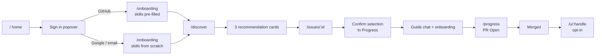

# Design — UI / UX Source of Truth

> Status: draft for review · Owner: frontend · Last updated: 2026-10-27
>
> This file is the single source of truth for **how the product looks, moves and speaks**.
> It is not a mood board and not a component library: every rule here is implementable with
> Next.js App Router, Tailwind, shadcn/ui and `motion`.
>
> Related: [`AGENTS.md`](../../AGENTS.md) · [`architecture.md`](../engineering/architecture.md) ·
> [`functional-requirements.md`](../requirements/functional-requirements.md) ·
> [`PROGRESS.md`](../PROGRESS.md)

---

## 1. The feeling in one paragraph

A quiet, dark room with one bright object in it. Near-black canvas, thin hairline borders,
one blue accent, and a single large idea per screen. Type does the work; chrome disappears.
Motion is used to **explain the product**, not to decorate it — the hero is a small machine
that shows an issue becoming a merged pull request. Nothing shouts, nothing sparkles,
nothing is a gradient for its own sake.

Reference: the supplied screenshot of *edinburgh* — dark canvas, centered trust pill,
oversized tight headline, two controls, product window floating below. We take the
**composition and restraint**, not its branding, copy or layout details.

---

## 2. Principles (use these to settle arguments)

| # | Principle | Test |
|---|---|---|
| 1 | **One primary action per screen** | If a screen has two filled blue buttons, one is wrong. |
| 2 | **Dark first, light equal** | Every screen is designed in dark, then re-checked in light. No "dark mode later". |
| 3 | **Type over decoration** | Remove a border, shadow or icon before removing a word. |
| 4 | **Motion explains, never entertains** | Every animation answers "what just happened?" or it is cut. |
| 5 | **Show the machine** | When the system searches, ranks or syncs, say so in words ("Ranking for you…"), never a bare spinner. |
| 6 | **Honest states** | Empty, slow, limited and failed are designed screens, not afterthoughts. |
| 7 | **Calm density** | App screens are denser than the marketing page but share the same tokens. |
| 8 | **No hidden hover-only actions** | Anything on hover also works on focus, tap and keyboard. |

---

## 3. What we take from the reference — and what we reject

| Take | Reject |
|---|---|
| Near-black canvas with a soft radial lift behind the hero | The centre navigation bar (product has no other public pages to link) |
| Small pill above the headline ("Trusted by…") | Two hero buttons (we ship exactly one) |
| 56–64px headline, tight tracking, sentence case | The browser-chrome mockup as a literal screenshot (ours is a live animation) |
| Muted grey subline, max 2 lines | Any stock photo, illustration or 3D blob |
| One blue filled CTA + one ghost control | Purple/indigo gradients and glassmorphism |
| Product window floating with 1px border and deep shadow | Fake "10,000+ users" claims we cannot prove |
| Generous vertical rhythm (~96–128px between blocks) | Long marketing copy blocks and feature grids |

**Our trust pill reads:** `Built for first-time contributors` — true, and defensible in a demo.

---

## 4. Brand

| Item | Decision |
|---|---|
| Product name | **OpenSource-helper** (always capital O, capital S, hyphen) |
| Short name in UI chrome | **OSH** (only where space is under 64px) |
| Logo | A 20×20 mark: two chevrons `>_` merged into a single bracket, drawn as 2px strokes. Wordmark in Geist Medium, `-0.02em`. |
| Logo colours | Mark uses `--accent`; wordmark uses `--fg` |
| Voice | Direct, second person, no hype. "Pick an issue. We'll explain the repo." |
| Never say | "Revolutionary", "supercharge", "unleash", "AI magic", "10x" |
| Emoji | Not in UI copy. Not in buttons. Not in empty states. |

### Name in sentences

- Home: "OpenSource-helper" once in the footer only — the hero does not repeat the brand.
- Auth: "Continue to OpenSource-helper".
- Emails: "OpenSource-helper · no-reply@…".

---

## 5. Colour

### 5.1 Palette logic

We use GitHub's **semantic palette structure** (canvas / border / fg / accent / status), because
developers already read those colours correctly. We do **not** use GitHub's logo or brand assets.

Three palettes, one set of semantic names. Components never reference a raw hex — only a token.
The default is **GitHub Dark** (`.github`): canvas `#010409`, subtle `#0D1117`, inset `#000000`,
borders `#21262D`, accent `#4493F8`. The `.dark` palette below is the softer original dark; light
is opt-in. Tokens live in `app/globals.css`; the default and the toggle order live in `lib/theme.ts`.

### 5.2 Dark theme (soft)

| Token | Hex | Use |
|---|---|---|
| `--canvas-default` | `#0D1117` | Page background |
| `--canvas-subtle` | `#161B22` | Cards, popovers, app shell panels |
| `--canvas-inset` | `#010409` | Product window, code-adjacent surfaces |
| `--canvas-overlay` | `rgba(1,4,9,0.72)` | Dialog scrim (with 8px blur, optional) |
| `--border-default` | `#30363D` | Card and input borders |
| `--border-muted` | `#21262D` | Dividers inside cards |
| `--border-strong` | `#484F58` | Hover border on interactive cards |
| `--fg-default` | `#E6EDF3` | Headlines, primary text |
| `--fg-muted` | `#8B949E` | Body, secondary text |
| `--fg-subtle` | `#6E7681` | Labels, timestamps, placeholders |
| `--accent` | `#2F81F7` | Primary button, links, focus ring |
| `--accent-hover` | `#4C8DF8` | Hover |
| `--accent-subtle` | `rgba(56,139,253,0.15)` | Selected row, active nav, reason chip |
| `--success` | `#3FB950` | Merged, completed, extraction done |
| `--attention` | `#D29922` | Fallback ranking, stale sync, warnings |
| `--danger` | `#F85149` | Errors, destructive actions |
| `--done` | `#A371F7` | Badges, achievements (used sparingly) |

### 5.3 Light theme

| Token | Hex |
|---|---|
| `--canvas-default` | `#FFFFFF` |
| `--canvas-subtle` | `#F6F8FA` |
| `--canvas-inset` | `#F6F8FA` |
| `--border-default` | `#D0D7DE` |
| `--border-muted` | `#D8DEE4` |
| `--border-strong` | `#AFB8C1` |
| `--fg-default` | `#1F2328` |
| `--fg-muted` | `#59636E` |
| `--fg-subtle` | `#6E7781` |
| `--accent` | `#0969DA` |
| `--accent-hover` | `#0550AE` |
| `--accent-subtle` | `rgba(9,105,218,0.10)` |
| `--success` | `#1A7F37` |
| `--attention` | `#9A6700` |
| `--danger` | `#CF222E` |
| `--done` | `#8250DF` |

### 5.4 Usage rules

1. **One accent.** Blue means "this is the next thing to do". Never use blue for decoration.
2. **Status is never colour-only.** Always icon + text + colour (e.g. `● Merged`).
3. **Contrast minimums:** 4.5:1 for body, 3:1 for ≥24px text and UI borders.
4. **No pure black (`#000`) and no pure white (`#FFF`) text on canvas.** Both themes are softened.
5. **Gradients allowed in exactly one place:** the radial spotlight behind the hero
   (`transparent → --accent-subtle` at 12% opacity, 600px radius). Nowhere else.
6. **Shadows:** dark theme uses a 1px border + `0 24px 80px rgba(0,0,0,0.55)` on the hero window only.
   Light theme uses `0 24px 60px rgba(31,35,40,0.12)`. Cards elsewhere get no shadow.

### 5.5 Theme switching

- Default: `system`, stored in a cookie so the first paint is correct (no flash).
- Toggle lives in the **footer** on public pages and in **Settings → Appearance** in the app.
- The sign-in popover also exposes it as a 2-icon segmented control (small, bottom row).
- `class="dark"` on `<html>`; all tokens are CSS variables so the swap is instant, no re-render.

---

## 6. Typography

### 6.1 Families

| Role | Family | Notes |
|---|---|---|
| UI + display | **Geist Sans** (`next/font/local` or Google) | Neo-grotesk, close to the reference, ships with Next, zero layout shift |
| Code, numbers, eyebrows | **Geist Mono** | File paths, token counts, PR numbers, the small uppercase scene labels |

Fallback stack: `ui-sans-serif, system-ui, -apple-system, "Segoe UI", sans-serif` and
`ui-monospace, "SFMono-Regular", monospace`.

**One family, two widths.** Do not add a third typeface.

### 6.2 Scale

| Token | Size / line-height | Weight | Tracking | Use |
|---|---|---|---|---|
| `display-xl` | `clamp(40px, 6vw, 72px)` / 1.02 | 600 | `-0.045em` | Home H1 only |
| `display-lg` | `clamp(32px, 4vw, 48px)` / 1.08 | 600 | `-0.035em` | Onboarding H1, page titles |
| `h1` | 32 / 1.15 | 600 | `-0.02em` | App page title |
| `h2` | 24 / 1.25 | 600 | `-0.015em` | Section title |
| `h3` | 18 / 1.4 | 600 | `-0.01em` | Card title |
| `body-lg` | 18 / 1.6 | 400 | `0` | Hero subline |
| `body` | 15 / 1.6 | 400 | `0` | Default |
| `body-sm` | 13 / 1.5 | 400 | `0` | Metadata, helper text |
| `label` | 12 / 1.2 | 500 | `0.08em`, uppercase | Eyebrows, scene captions |
| `mono-sm` | 12 / 1.4 | 500 | `0` | Numbers, SHAs, paths |

Rules:

- Headlines are **sentence case**, never Title Case, never ALL CAPS (except `label`).
- Max line length: 68 characters (`~62ch` for chat), enforced with `max-w-[62ch]`.
- Never center-align body copy longer than two lines.
- Tabular numbers (`font-variant-numeric: tabular-nums`) in admin tables and counters.

---

## 7. Space, radius, border, elevation

### 7.1 Spacing scale (4px base)

`4 · 8 · 12 · 16 · 20 · 24 · 32 · 40 · 48 · 64 · 80 · 96 · 128`

No arbitrary values (`13px`, `2.3rem`). Section rhythm on public pages: 96px desktop / 64px mobile.

### 7.2 Radius

| Token | Value | Use |
|---|---|---|
| `radius-sm` | 6px | Buttons, inputs, chips |
| `radius-md` | 10px | Cards, popovers |
| `radius-lg` | 14px | Hero window, dialogs, sheets |
| `radius-full` | 999px | Pills, avatars, status dots |

### 7.3 Border

Always `1px`. Hairlines are `--border-muted`. Hover raises to `--border-strong`.
Never a 2px border except the focus ring.

### 7.4 Elevation

| Level | Dark | Light | Use |
|---|---|---|---|
| 0 | none | none | Page |
| 1 | `0 1px 0 rgba(255,255,255,0.03)` inset | none | Sticky header |
| 2 | `0 24px 80px rgba(0,0,0,0.55)` | `0 24px 60px rgba(31,35,40,0.12)` | Hero window, dialogs |
| 3 | `0 8px 24px rgba(0,0,0,0.4)` | `0 8px 24px rgba(31,35,40,0.10)` | Popovers, dropdowns |

---

## 8. Iconography and imagery

- **Icons:** `lucide-react`, 16px in dense UI, 20px in buttons, 24px in empty states.
  Stroke width `1.75`, `currentColor`. Never mix icon families.
- **Illustration:** none. Empty and error states use one icon + words.
- **Photography:** none.
- **Product visuals:** only the live hero animation and real UI (screenshots of the actual app in the demo).
- **Avatars:** GitHub avatar → `radius-full`, 24/32/40px. Fallback = initials on `--accent-subtle`.
- **Logo/brand assets:** one SVG mark + wordmark, `currentColor`.

---

## 9. Motion system

### 9.1 Tokens

| Token | Value | Use |
|---|---|---|
| `dur-instant` | 90ms | Hover colour, press |
| `dur-fast` | 150ms | Popover in, tab underline, chip add |
| `dur-base` | 220ms | Card hover, accordion, toast |
| `dur-slow` | 340ms | Dialog, sheet, page section reveal |
| `dur-hero` | 600ms | Hero scene transitions |
| `ease-out` | `cubic-bezier(0.22, 1, 0.36, 1)` | Default enter |
| `ease-in-out` | `cubic-bezier(0.65, 0, 0.35, 1)` | Morphs |
| `spring-card` | `{ stiffness: 260, damping: 26, mass: 0.9 }` | Rank chips, selection lift |

### 9.2 Rules

1. Animate **transform, opacity and filter only**. Never `width`, `height`, `top`, `left`, `margin`.
2. Max **3 elements** moving at once in app UI. The hero is the exception (choreographed).
3. Stagger lists by **40ms**, cap at 8 items (the 9th+ appears together).
4. No looping animation outside the hero. No pulsing "AI" dots, no shimmer on text.
5. Every animation has a job: confirm (press), orient (where did this come from), or explain (pipeline).
6. **`prefers-reduced-motion: reduce`** ⇒ all durations to 90ms crossfade, no transforms,
   hero stops on frame 1 and shows a "Play the 15-second story" button.
7. Pause hero when offscreen (`IntersectionObserver`) or tab hidden (`visibilitychange`).
8. 60fps budget: the hero must not drop frames on a 2019 laptop. Test with 4× CPU throttle.

### 9.3 Page transitions

No full-page slide transitions. Sections fade + 8px rise, once, on first paint
(`dur-slow`, `ease-out`). Route changes are instant; only the new content animates.
Tab panels crossfade 150ms with a 2px underline sliding (transform only).

---

## 10. Layout and responsive

### 10.1 Grid

- Public pages: max-width **1120px**, 24px gutters, single centered column.
- App: sidebar **240px** (collapsed 64px) + content max **1200px**, 32px gutters.
- Chat: context rail **320px** + thread max **720px**.
- 12-column grid available but not mandatory; most app screens are 1 or 2 columns.

### 10.2 Breakpoints

| Name | Width | Behaviour |
|---|---|---|
| `sm` | ≥ 640 | 2-column card grids |
| `md` | ≥ 768 | Sidebar appears (overlay below), 2-pane chat |
| `lg` | ≥ 1024 | Persistent sidebar, 3 recommendation cards in a row |
| `xl` | ≥ 1280 | Max widths kick in |

### 10.3 Mobile rules

- Hero: H1 `clamp` handles it; the product window becomes **full-bleed with 12px gutters**,
  chrome dots hidden, animation simplified to 3 scenes (no typewriter).
- App nav becomes a **bottom bar with 4 items**: Discover · Progress · Guide · Profile.
- Recommendation cards stack; the "why this fits" is always visible (never behind a tap).
- Filters open in a bottom sheet with an "Apply" button and a visible count.
- Tables become definition lists. No horizontal scrolling except code/paths, which wrap.

---

## 11. Information architecture

### 11.1 Route map

| Route | Auth | Purpose | FR |
|---|---|---|---|
| `/` | public | Home: one CTA, one animation | — |
| `/login` · `/signup` | public | Direct-link pages for the popover's actions | FR-1 |
| `/auth/callback` | public | OAuth return, then redirect | FR-1 |
| `/forgot-password` · `/reset-password` | public | Reset flow | FR-1 |
| `/onboarding` | developer | 3-step setup, centered | FR-2, FR-3 |
| `/discover` | developer | Filters + exactly 3 recommendations | FR-4, FR-5 |
| `/issues/[id]` | developer | Details, onboarding, guide, progress | FR-6, FR-8–11 |
| `/progress` | developer | In Progress / PR Open / Merged | FR-8 |
| `/saved` | developer | Lists and saved issues | FR-7 |
| `/notifications` | developer | Inbox + preferences | FR-13 |
| `/achievements` | developer | Badges, streaks, visibility | FR-16 |
| `/settings/profile` | developer | Skills, level, languages, CV | FR-2, FR-3, FR-14 |
| `/settings/account` | developer | Name, username, avatar, password, GitHub, delete | FR-1, FR-14 |
| `/settings/notifications` | developer | Channels + frequency | FR-13 |
| `/community` | developer/maintainer | Contributor search | FR-17 |
| `/community/[login]` | developer/maintainer | Contributor detail | FR-17 |
| `/requests` | developer/maintainer | Sent/received outreach + chat | FR-18 |
| `/learn` · `/learn/[topic]` | public | Guides + topic search | FR-12 |
| `/u/[handle]` | public | Opt-in public profile + OG image | FR-15 |
| `/admin` | admin | Metrics dashboard | FR-19 |
| `/admin/ai` | admin | AI settings vs usage | FR-20 |

### 11.2 Golden path



### 11.3 Navigation (app)

Sidebar, top to bottom: **Discover · Progress · Saved · Community · Learn**, divider,
**Notifications · Settings**. Admin sees an **Admin** group (Dashboard · AI) above the divider.
No nested menus deeper than 2 levels.

---

## 12. Home page `/`

### 12.1 Structure (top to bottom)

| # | Element | Notes |
|---|---|---|
| 1 | Top bar | Logo left. Right: theme icon (24px, ghost), `Sign in` button. **No nav links.** Height 64px, transparent over the hero, 1px bottom border on scroll only. |
| 2 | Trust pill | `Built for first-time contributors` · 12px mono uppercase, 1px border, `radius-full`, 6px×12px padding. |
| 3 | H1 | **"Find it. Learn it. Merge it."** |
| 4 | Subline | "Open-source issues matched to your skills, explained step by step, guided to a merged pull request — without anyone writing the code for you." Max 2 lines, `--fg-muted`. |
| 5 | CTA | One button: **Get started** (accent, 44px, `radius-sm`, 16px/600). Under it, 12px `--fg-subtle`: `Free · GitHub or Google · 2 minutes to set up`. |
| 6 | Product window | The animation described in 12.2. Width 1120, 16:9-ish (1120×640), `radius-lg`. |
| 7 | Optional strip | Three items, one line each: `01 Matched to you` / `02 Explained, not solved` / `03 Tracked to merged`. **Cut this if the page feels long** — it is the only section allowed between hero and footer. |
| 8 | Footer | One row, 13px: `© 2026 OpenSource-helper` · GitHub · Privacy · Terms · theme toggle. No sitemap, no newsletter. |

Vertical rhythm: 64px top bar → 72px to pill → 24px to H1 → 24px to subline → 32px to CTA →
80px to window → 96px to footer.

### 12.2 Hero animation — "the 15-second story"

A **live DOM/SVG scene** inside a fake app window. Not a video, not a GIF, not a Lottie file:
it must be crisp, theme-aware, translatable and accessible.

**Frame**

- Window: `--canvas-inset`, 1px `--border-default`, `radius-lg`, elevation 2.
- Chrome bar 36px: three 8px dots (`#F85149`, `#D29922`, `#3FB950` at 70% opacity), centered
  URL pill in mono 11px: `opensource-helper.app/discover`.
- Below chrome: the scene canvas, 1120×604, clipped.

**Scene timeline (15s loop, 2s hold at the end)**

| Time | Scene | What moves | Caption (mono 11px, bottom-left) |
|---|---|---|---|
| 0.0–0.6 | Appear | Window fades 0→1, y +12→0, spotlight breathes in | — |
| 0.6–3.6 | **Search** | 9 dimmed issue cards drift up in a 3×3 grid with 40ms stagger; a scan line sweeps left→right; counter rolls `12,480 open issues` | `SEARCHING GITHUB` |
| 3.6–7.0 | **Rank** | Cards collapse to 3 (others fade + scale 0.96); rank chips `1 2 3` spring in; "why this fits" lines type on, 2 lines max | `RANKING FOR YOU` |
| 7.0–10.2 | **Learn** | Cursor selects card 1; it lifts 4px, others fade; right panel slides in with 3 checklist rows (Read the README → Run the tests → Open a PR) | `EXPLAINING THE REPO` |
| 10.2–13.0 | **Merge** | Panel becomes a status pill: `In Progress` → `PR Open` → `Merged` (green, check icon). A single ring pulse, no confetti | `SYNCED FROM GITHUB` |
| 13.0–15.0 | Hold | Everything still; caption `YOUR FIRST MERGED PR` | — |

**Implementation constraints**

- Build scenes as absolutely-positioned layers with `transform`/`opacity` only.
- Orchestrate with `motion` (`useAnimate` or variants); CSS for the scan line and caret.
- Reduced motion: render frame at 3.6s (three ranked cards) as a static image-like state,
  plus a button "Play the story" that runs one pass with animations.
- Pause offscreen and on hidden tab; resume from the same scene, never restart.
- No layout thrash: fixed scene height, `contain: layout paint`, `will-change` only during motion.
- Text inside the scene is **real text**, not an image — it must pass contrast and be readable
  at 1280px width. Hide captions below 768px.
- The window is the LCP element: server-render a static skeleton of scene 1, hydrate the animation
  after `requestIdleCallback`.

### 12.3 What the home page must not have

Navigation links, pricing, testimonials, logo walls, feature grids, FAQ, newsletter, cookie banner
(it is a first-party cookie only), chatbot bubble, "scroll to explore" hints, or a second CTA.

---

## 13. Authentication

### 13.1 Sign-in popover (the only auth entry on home)

**Trigger:** `Sign in` in the top-right. Ghost button, 36px, 13px/500.

**Behaviour**

| Input | Result |
|---|---|
| Hover | Opens after **120ms intent delay** (avoids flicker while crossing) |
| Click / tap / Enter / Space | Opens immediately, focus moves to the first provider button |
| `Escape` | Closes, focus returns to the trigger |
| Click outside | Closes |
| Focus moves outside | Closes |
| Touch | Tap opens (hover is never required) |

**Panel:** 360px, `--canvas-subtle`, 1px border, `radius-md`, elevation 3, top-right aligned
with an 8px offset. Enter: opacity 0→1 + scale 0.98→1 + y −4→0, `dur-fast`.
`role="dialog"`, `aria-modal="false"`, `aria-labelledby` on the title.

**Contents, top to bottom**

1. `Continue with GitHub` — full-width, **filled** (this is the primary path; it pre-fills skills).
   GitHub mark 18px + label. Helper line under: `Skills filled from your repositories`.
2. `Continue with Google` — full-width, outlined.
3. Divider with `or` centered, 12px.
4. Email input, password input (with show/hide), `Continue` button (filled, full-width).
5. Row, 13px: `New here? Create an account` (link) · `Forgot password?` (link).
6. Bottom row, 11px `--fg-subtle`: theme segmented control (sun/moon) + `Terms · Privacy`.

**States**

- Inline field errors under the field, 13px `--danger`, never a toast.
- Loading: button label → `Connecting…` with a 14px spinner; all inputs disabled.
- OAuth failure returns to the panel with a red banner: `GitHub didn't return a code. Try again.`
- Rate limited: `Too many attempts. Try again in 60 seconds.` + disabled submit with countdown.
- Success: panel closes, a full-screen 400ms fade to the destination (`/onboarding` if new,
  `/discover` if returning).

### 13.2 Auth pages

`/login` and `/signup` exist for direct links, emails and bookmarks. They reuse the same card
(400px, centered, no marketing) so the popover and the page never diverge.

- `/signup`: name, email, password (min 8, strength hint), `Create account`, GitHub/Google, `Already have an account?`.
- `/login`: email, password, `Continue`, `Forgot password?`.
- `/forgot-password`: email → success state "Check your inbox" with the email echoed.
- `/reset-password`: new password + confirm, token errors handled (`Link expired — request a new one`).
- `/auth/callback`: centered logo + `Connecting GitHub…` + 3 skeleton lines; on error, a retry card.

### 13.3 Consent copy (shown once, before the OAuth redirect)

> **GitHub permissions** — We read your public profile, repositories and pull requests to
> pre-fill your skills and track your contribution. We never post, merge or change anything
> without you asking.

Buttons: `Continue to GitHub` · `Cancel`.

---

## 14. Onboarding `/onboarding`

Full-page, centered, **max 560px**, no sidebar, no top nav except a small logo and `Sign out`.
Progress is a 3-segment bar at the top (not numbered circles). Autosave per step; back is always safe.

### Step 1 — "What do you work with?"

| Field | Control | Rules |
|---|---|---|
| Experience level | 3-up segmented control: Beginner / Intermediate / Advanced | **Required.** Helper text changes per choice ("You've read code, haven't shipped a PR" / "You've shipped a few PRs" / "You review and maintain"). |
| Languages | Searchable multi-select chips (TypeScript, Python, Go, Rust, Java, C#, PHP, Ruby, …) | **Required, min 1.** Max 8. Chips removable with ×. |
| Skills | Tag input with suggestions, max 12 | Optional but encouraged. 2 rows visible, "+7 more". |
| Source badge | If GitHub connected: chips carry a small `GH` dot and a line appears: `Imported from your GitHub. Edit anything.` + `Refresh` link | Refresh never overwrites edits without a confirm dialog. |

Continue enabled only when level + 1 language. Inline message on the disabled button's row:
`Pick a level and one language to continue.` (not a tooltip).

### Step 2 — "Tell us about you"

| Field | Control | Rules |
|---|---|---|
| Bio / description | Textarea, 4 rows, counter `0/280` | Optional. Placeholder: "What are you learning right now?" |
| CV | Dropzone 100% × 140px, dashed 1px border | PDF/DOCX, ≤5MB. Optional. |

**CV states**

| State | UI |
|---|---|
| Idle | Upload icon, `Drop your CV or browse`, `PDF or DOCX · up to 5 MB` |
| Uploading | Progress bar (determinate) + `Uploading… 42%` + `Cancel` |
| Processing | Indeterminate bar + `Reading your CV… this takes ~20 seconds` + a `Continue in background` link |
| Done | Green check + `12 skills found` + chips (editable) + `Replace file` |
| Error (type/size) | Red inline: `That file is 8 MB. The limit is 5 MB.` + `Choose another` |
| Error (extraction) | Amber: `We couldn't read that PDF. You can add skills manually.` + `Retry` |

`Skip for now` is always available and moves to step 3. Skipping never blocks recommendations
as long as step 1 is complete (FR-2.3).

### Step 3 — "You're set"

Summary card: level, languages (chips), skills count, CV status. Two actions:
**Find my first issue** (accent, primary) and `Edit` (ghost, returns to step 1).
Above the button: `You can change all of this later in Settings.`

### Rules

- One question group per screen; no scrolling form.
- Enter advances when the step is valid; never submits the whole flow.
- Leaving mid-flow keeps drafts (server-side), and `/discover` redirects back here if the gate fails
  with a single line: `Finish your profile to see recommendations.`
- GitHub users: skills are **suggestions**, never silently authoritative. Show the source.

---

## 15. Discovery `/discover`

### 15.1 Header

`Your next contribution` (h1) + a completeness chip on the right (`Profile 80% · Add skills`).
Below: one sentence, muted: `Three issues chosen for your level and stack.`

### 15.2 Filters

A single row on desktop, a bottom sheet on mobile:

`Language ▾` · `Label ▾` (defaults to `good first issue`) · `Activity ▾` (active in 30/90 days) ·
`Organization` · `Repository` · `More` (opens a panel).

- Chips show the active value and an × to clear.
- A `Reset` text button appears only when something is active.
- Applying filters is explicit (`Apply` in the sheet); on desktop, changes apply on select.
- The filter bar is **sticky** under the top bar, 1px bottom border on scroll.

### 15.3 Primary action

`Find issues` before the first run; `Regenerate` after. While loading:
`Regenerate in 8s` with a disabled button and a thin progress line — never a second request.

Regenerate copy under the button: `New set. Ignored issues stay ignored.`

### 15.4 Loading (the pipeline, shown honestly)

Three skeleton cards + a stage line that advances:

1. `Searching GitHub…`
2. `Filtering 480 open issues…` (count is real when available)
3. `Ranking for you…`

The stage line is `aria-live="polite"` and changes at most every 1.5s.
Total target: **≤10s p95**. After 12s: `Still working — GitHub is slow right now.` + `Cancel`.
After 20s: fallback banner appears (see 15.7) and cards render.

### 15.5 Recommendation card (exactly three)

```
┌─────────────────────────────────────────────┐
│ ①  vercel/next.js            ● Active 2d   │
│                                             │
│  Add keyboard navigation to the docs search │
│                                             │
│  Why this fits you                          │
│  You know TypeScript and have shipped UI    │
│  fixes. This is scoped, labeled good first  │
│  issue, and has a maintainer reply.         │
│                                             │
│  TypeScript · Beginner · good first issue   │
│                                             │
│  View details        ☆ Save      ✕ Ignore   │
└─────────────────────────────────────────────┘
```

| Element | Rule |
|---|---|
| Rank | 24px circle, `--accent-subtle` bg, mono 12px number. Not a medal, not gold. |
| Repo | `owner/name`, 13px mono, muted. Truncate with ellipsis at 32ch. |
| Activity | Dot + `Active 2d` / `Quiet 41d` (amber if >30d). |
| Title | 18px/600, max 2 lines, clamps. |
| Reason | 13px, `--fg-muted`, **max 3 lines** (contract caps `reason` at 180 chars). Label `Why this fits you` in 11px mono uppercase. |
| Meta chips | Max 3 visible + `+2`. Never wrap to 3 rows. |
| Actions | `View details` (ghost), `Save` (icon + label), `Ignore` (icon + label). Ignore asks no confirm; it shows an undo toast for 5s. |
| Hover | Border → `--border-strong`, translateY(−2px), `dur-base`. No shadow. |
| Whole card | Not clickable except the title and `View details` (avoids hijacking text selection). |

Cards animate in with 40/80/120ms stagger, `opacity` + 8px rise.

### 15.6 Empty and error states

| Case | UI |
|---|---|
| No matches | Icon + `No suitable issues in this slice.` + `Widen the activity window or drop the label filter.` + `Broaden filters` (returns with filters pre-cleared one at a time) |
| All excluded | `Everything here was already seen, saved or ignored.` + `Show ignored` link |
| GitHub rate limited | Amber banner: `GitHub is rate-limiting us. Showing cached results from 12 minutes ago.` + `Retry in 4m` |
| AI unavailable | Amber banner: `Ranked by rules — the AI is unavailable. These still match your stack.` Cards keep the same layout; reason text is replaced by `Matched on TypeScript + beginner-friendly label.` |
| Profile gate | Redirect to onboarding with the one-line explanation |
| Limit reached | Full-card state: `You've reached this month's AI limit.` + reset date + `Browse saved issues` |

### 15.7 Ignore and save feedback

- Save: icon fills, toast `Saved to “Later”` + `Undo`.
- Ignore: card fades and scales to 0.98 (`dur-base`), then the grid reflows in one step using
  `motion`'s `layout` (transform only); toast `Ignored. It won't be recommended again.` + `Undo`.
- Never a modal for either action.

---

## 16. Issue detail `/issues/[id]`

### 16.1 Layout

Two columns ≥1024px: main (max 720) + sticky rail (320). Mobile: single column, rail becomes a
sticky bottom action bar.

### 16.2 Header

Breadcrumb `Discover / vercel/next.js` (13px, muted).
Title 32/600. Under it: status pill, `#48213` mono, `Open on GitHub ↗` (external icon),
`Saved` toggle, overflow menu (`Ignore`, `Copy link`).

### 16.3 Tabs

`Overview` · `AI guide` · `Progress`. Underline indicator 2px accent, slides on change.
URL-synced (`?tab=guide`) so a refresh keeps the tab and links are shareable.

### 16.4 Overview (FR-9 / FR-10)

| Block | Content | Rule |
|---|---|---|
| Summary | 2–3 sentences on what the issue asks | No code |
| What you'll need | Chips: language, level, concepts | Max 6 |
| Where to start | 3–5 rows: file path (mono) + one-line reason | Paths only, no snippets |
| Prerequisites | Checklist (account, fork, tests run locally) | Checkable, stored locally |
| Resources | 2–4 links (docs, CONTRIBUTING, related issue) | External icon, `rel="noopener"` |
| Generated note | `Generated from README @ a1b2c3d · updated 2d ago` | Honest provenance |

Sticky rail: `Work on this issue` (accent), `Save` (ghost), `Ask the guide` (ghost).
Under the CTA, 12px muted: `You can change your mind later.`

### 16.5 Confirm dialog

Title: `Work on this issue?`
Body: `It becomes your active issue and moves to In Progress. The guide will use this repository's context.`
Actions: `Cancel` (ghost) · `Start working` (accent).
On confirm: dialog closes, header status pill morphs to `In Progress` (200ms), toast with `Open guide`.

### 16.6 Progress tab

Vertical timeline: `Selected` → `In Progress` → `PR Open` → `Merged`, each with date and source
(`manual` / `synced from GitHub`). Current step has an accent ring. Below: `Update status` and
`Attach pull request` (dialog: status select + URL input with `https://github.com/.../pull/` validation).
Note: `We check GitHub every 5 minutes.`

---

## 17. AI guide `/issues/[id]?tab=guide`

### 17.1 Layout

Desktop: context rail 320 (repo, issue title, "what we know", suggested questions) + thread 720.
Mobile: thread full width; context in a top sheet triggered by `Context`.

### 17.2 Thread

- Guide messages: no bubble; avatar 24px + name `Guide` + text. Max 62ch.
- User messages: right-aligned bubble, `--canvas-subtle`, 1px border, max 80%.
- Timestamps 11px muted, shown on hover/focus only.
- No code blocks. If the model emits one, the guardrail replaces it before render (see 17.4).
- Streaming: 2px caret, text appears at reading speed; `Stop` button replaces `Send`.
- Scroll: sticks to bottom unless the user scrolls up; then a `Jump to latest` pill appears.

### 17.3 Composer

Textarea 1–6 rows, auto-grow, `Enter` sends, `Shift+Enter` newline.
Left: token/limit hint `1,240 / 20,000 tokens this month` (mono 11px, muted).
Right: `Send` (accent, 32px icon button). Disabled while streaming or over limit.

Suggested prompts (chips above the composer, disappear after the first message):
`Explain this repository` · `What should I read first?` · `How do I run the tests?` · `What does this error mean?`

### 17.4 Refusal state (product rule — design it as a feature)

When the guardrail blocks a request for a solution, show a distinct panel, **not an error**:

```
🛡  I can't write the fix for you — but I can get you there.

   1. Reproduce the bug locally and note the exact error.
   2. Open src/app/docs/search.tsx and find the keydown handler.
   3. Compare it with the pattern used in the command menu.
   4. Ask me what a specific line does, or how to verify your change.

   [ Ask about step 2 ]   [ Show related docs ]
```

- Border-left 2px `--attention`, background `--canvas-subtle`, no red.
- Heading 16/600; steps as an ordered list, 15px.
- Never include a diff, a patch, or a complete function.
- If a code block was stripped: append a 13px muted line:
  `I removed a code block from that answer. Ask me for the next step instead.` + `Why?` popover.

### 17.5 Other chat states

| State | UI |
|---|---|
| Thinking | Three 4px dots (opacity loop, reduced-motion: static `Thinking…`) + `Reading the issue and 3 files…` |
| Empty history | Guide intro card: what it can do, what it won't, 4 suggested prompts |
| Limit reached | Composer disabled + banner `You've used your monthly AI budget. It resets on 1 Nov.` + `Browse learning resources` |
| AI down | `The guide is offline right now. Your history is safe.` + `Try again` + link to the issue's resources |
| Guardrail error | `Something in that answer didn't meet our guidance rules. Ask again a different way.` |
| Long conversation | `Load earlier messages` at top; no infinite scroll upward |

---

## 18. Progress `/progress`

### 18.1 Header

`Your contributions` + counts: `2 In Progress · 1 PR Open · 4 Merged` (mono, tabular).
Right: `Sync now` ghost button with a live dot; last sync `updated 2m ago` (11px muted).

### 18.2 Board

Three columns ≥1024 (`In Progress`, `PR Open`, `Merged`), stacked sections below.
Card: repo `owner/name`, issue title (2 lines), status pill, `PR #123` link if present,
footer `Selected 12 Oct · synced 2m ago`. Click → issue detail.

- Column headers show counts and a 1px top border in the status colour.
- Empty column: `Nothing here yet.` + `Find an issue` (only in In Progress).
- Merged cards get a subtle `--success` left edge (2px), no confetti.
- Drag-and-drop is **not** supported; status comes from GitHub or the update dialog (honesty > novelty).

### 18.3 Manual update dialog

`Update status` → select (`In Progress`, `PR Open`, `Merged`, `Paused`) + PR URL (optional) +
helper `GitHub sync will correct this within 5 minutes.` Save is optimistic with rollback on error.

---

## 19. App shell, settings, notifications, achievements

### 19.1 Shell

- Sidebar 240px, `--canvas-subtle`, 1px right border. Item 36px, radius 6, icon 18 + label 14.
  Active: `--accent-subtle` bg + 2px left accent bar + `--fg-default`.
- Top bar 56px: breadcrumb/page title left; right: search (`/` shortcut), bell with unread dot,
  avatar menu (Profile, Settings, Theme, Sign out).
- Content: max 1200, padding 32 (24 mobile).
- Mobile: bottom bar (Discover, Progress, Guide, Profile) + the top bar keeps the bell.

### 19.2 Settings

Tabs: `Profile` · `Account` · `Notifications` · `Appearance`.
Two-column form on desktop (label 200 + control), single column mobile. Save bar appears only
when dirty (`You have unsaved changes` + Save/Cancel), sticky at the bottom.
Destructive actions (disconnect GitHub, delete account) live in a `Danger zone` card with a
confirm dialog that requires typing the username.

### 19.3 Notifications

List rows 64px: unread dot 6px accent, icon by type, title 14/500, body 13 muted (1 line),
relative time right. Click marks read and navigates. `Mark all read` top-right.
Empty: `Nothing yet. We'll tell you when your PR moves.`
Preferences: two groups (Channels: In-app/Email; Frequency: Instant/Daily/Weekly) + event toggles.
Every toggle saves immediately with a 12px `Saved` flash, no Save button.

### 19.4 Achievements

Grid of badges 3-up (2-up mobile). Earned: `--done` icon, name, date. Locked: 40% opacity,
name + requirement line, no date. Streak card: current / longest, 7-dot week strip.
`Show on public profile` switch per badge, disabled with a hint until the profile is published.

### 19.5 Community and requests

- Search: large input `org or owner/repo`, language/topic chips, results ranked list.
  Row: avatar, name, `@login`, activity sparkline (last 12 weeks), top languages, `View`.
- Outreach composer: type (Mentorship / Recruitment), message 500 chars, opt-in state,
  rate-limit banner, `Send request`. If the recipient is not opted in: show their GitHub link only.
- Requests: tabs Received / Sent, status chips, conversation view after acceptance.
- Block: confirm dialog, then the sender disappears from both lists.

### 19.6 Admin

Same tokens, density up: 36px table rows, 13px text, sticky header, `tabular-nums`.
Top: 4 metric cards (registered, logged in, suggested, regenerated). Then status counts as a
horizontal stacked bar + legend. AI usage: period filter (7/30/90 days, custom), table by feature
(tokens, requests, cost), and a freshness chip `updated 2m ago` with a 5-minute threshold.
If stale >5 min: amber `Data may be stale` + `Refresh`.
Settings card: max tokens/user, temperature slider 0–1 (step 0.1), usage limit, `Save`.
Show a live preview: `At 0.4, answers are focused. At 0.9, more creative — and less predictable.`

---

## 20. Public pages

### 20.1 Public profile `/u/[handle]`

- Header: avatar 64, name, `@handle`, one-line bio, `Merged 4 · PRs 6 · Badges 3` (mono).
- Sections gated by visibility: Languages, Merged contributions (repo + issue + date),
  Badges, Streak. Hidden sections are absent, not greyed.
- `Copy link` (ghost) + `Share on X`? No — copy link only.
- Private/unpublished: a calm card `This profile is private.` with no data leak.
- OG image: 1200×630, dark canvas, name + handle + 3 stats + logo. Generated from tokens.
- The page must render without JS and without auth.

### 20.2 Learning hub `/learn`

Search input + topic chips (Git basics, Branches, Pull requests, Reviews, Tests, Etiquette).
Article layout: 68ch measure, h2/h3 only, no code blocks longer than 12 lines, copy button,
"Was this helpful?" at the end. Index is static and indexable.

---

## 21. Component inventory

All live in `apps/web/components/ui` (shadcn base) or `apps/web/components/<feature>`.
Only these variants exist; a new variant needs a line in this file.

| Component | Variants | Notes |
|---|---|---|
| `Button` | `primary`, `secondary` (outlined), `ghost`, `danger`; sizes `sm 32`, `md 40`, `lg 44` | One `primary` per view |
| `IconButton` | ghost, 32/36 | Requires `aria-label` |
| `Input` / `Textarea` | default, error, disabled | Label above, helper below, error replaces helper |
| `Select` | single, multi (chips) | Radix, keyboard complete |
| `Checkbox` / `Switch` | — | Switch saves immediately, checkbox in forms |
| `Card` | `flat`, `interactive` | `interactive` gets hover border + −2px |
| `Pill` | `neutral`, `accent`, `success`, `attention`, `danger`, `done` | Always icon or dot + text |
| `Tabs` | underline | URL-synced where it changes content |
| `Dialog` | `sm 400`, `md 520`, `lg 720` | Focus trap, `Esc`, scrim click |
| `Sheet` | bottom (mobile), right (filters) | Drag-to-dismiss |
| `Popover` | — | Used by sign-in and avatar menus |
| `Toast` | default, success, danger, undo | Bottom-center mobile, bottom-right desktop, 5s |
| `Tooltip` | — | 400ms delay, never the only label |
| `Skeleton` | line, card, avatar | Shimmer 1.4s, disabled under reduced motion |
| `EmptyState` | — | Icon + title + one line + one action |
| `ErrorState` | — | Icon + what happened + retry + support link |
| `Stepper` | 3-segment | Onboarding only |
| `Dropzone` | idle/uploading/processing/done/error | 6 states specified in §14 |
| `RecommendationCard` | — | Exactly 3 per view |
| `StatusPill` | in-progress, pr-open, merged, paused | Icon + text + colour |
| `ChatMessage` | guide, user, refusal, system | No code rendering |
| `TokenMeter` | inline, block | Mono numbers, never a red bar until 90% |
| `Avatar` | 24/32/40/64, fallback initials | |
| `Logo` | mark, wordmark, full | SVG, currentColor |

---

## 22. State matrix (every screen must answer these)

| Screen | Loading | Empty | Error | Unauthorized | Limit |
|---|---|---|---|---|---|
| Home | SSR static | — | — | — | — |
| Auth popover | button spinner | — | inline banner | — | countdown |
| Onboarding | step skeleton | — | field-level | redirect | — |
| Discover | 3 skeletons + stage | broaden filters | banner + retry | redirect | limit card |
| Issue detail | block skeletons | — | retry block | 404 card | — |
| Guide | thinking dots | intro card | offline card | 404 | composer disabled |
| Progress | 3 column skeletons | per column | sync banner | redirect | — |
| Saved | list skeleton | `Nothing saved` | retry | redirect | — |
| Notifications | rows skeleton | `Nothing yet` | retry | redirect | — |
| Community | list skeleton | `No contributors` | retry | redirect | — |
| Public profile | SSR | `No activity yet` | 404 | — | — |
| Admin | cards skeleton | `No data for this period` | retry | 403 page | — |

404 page: `This page doesn't exist.` + `Go home`. 403: `You don't have access to this.` +
`Back to discover`. Both use the same calm layout — no illustrations.

---

## 23. Accessibility (WCAG 2.1 AA — non-negotiable)

- **Focus:** 2px `--accent` ring + 2px offset on every interactive element; `:focus-visible` only.
- **Keyboard:** the sign-in popover, dialogs, sheets, tabs, selects and chips are fully operable.
  Hover is never the only trigger (this is why the popover opens on focus and click too).
- **Skip link:** `Skip to content` as the first focusable element in the app shell.
- **Landmarks:** one `<main>`, `<nav aria-label="Primary">`, `<header>`, `<footer>`.
- **Headings:** one `h1` per page, no skipped levels.
- **Live regions:** pipeline stage line `aria-live="polite"`; streaming answers announce **once on
  completion**, not per token; toasts `role="status"`.
- **Forms:** every input has a `<label>`; errors linked with `aria-describedby`; `aria-invalid`.
- **Status:** icon + text, never colour alone. `Merged` has a check icon; `Active 2d` has a dot and words.
- **Targets:** 44×44 minimum on touch; 32px allowed for dense desktop icon buttons with spacing.
- **Contrast:** verified per theme; muted text on `--canvas-subtle` is the pair most likely to fail —
  check it with a contrast tool, not by eye.
- **Motion:** `prefers-reduced-motion` honoured globally, including the hero and skeletons.
- **Zoom:** usable at 200% and 320px width; no horizontal scroll.
- **Screen reader pass:** one manual NVDA/VoiceOver run of the golden path before release.

---

## 24. Copy deck

| Where | Copy |
|---|---|
| Trust pill | `Built for first-time contributors` |
| H1 | `Find it. Learn it. Merge it.` |
| Subline | `Open-source issues matched to your skills, explained step by step, guided to a merged pull request — without anyone writing the code for you.` |
| CTA | `Get started` |
| CTA microcopy | `Free · GitHub or Google · 2 minutes to set up` |
| Sign-in title | `Sign in` |
| GitHub button | `Continue with GitHub` |
| GitHub helper | `Skills filled from your repositories` |
| Google button | `Continue with Google` |
| Signup link | `New here? Create an account` |
| Onboarding step 1 | `What do you work with?` |
| Onboarding step 2 | `Tell us about you` |
| Onboarding step 3 | `You're set` |
| Onboarding CTA | `Find my first issue` |
| Discover title | `Your next contribution` |
| Discover empty | `No suitable issues in this slice.` |
| Discover fallback | `Ranked by rules — the AI is unavailable. These still match your stack.` |
| Reason label | `Why this fits you` |
| Select CTA | `Work on this issue` |
| Confirm title | `Work on this issue?` |
| Confirm body | `It becomes your active issue and moves to In Progress. The guide will use this repository's context.` |
| Guide refusal | `I can't write the fix for you — but I can get you there.` |
| Guide stripped code | `I removed a code block from that answer. Ask me for the next step instead.` |
| Guide limit | `You've used your monthly AI budget. It resets on 1 Nov.` |
| Progress empty | `Nothing here yet.` |
| Notifications empty | `Nothing yet. We'll tell you when your PR moves.` |
| Sync note | `We check GitHub every 5 minutes.` |
| Profile gate | `Finish your profile to see recommendations.` |
| 403 | `You don't have access to this.` |
| 404 | `This page doesn't exist.` |

Rules: sentence case; no exclamation marks; no "Oops"; no "Uh oh"; no emoji; error copy says
**what happened** and **what to do next**, never blames the user.

---

## 25. Implementation mapping

### 25.1 Where things live

```
apps/web/
  app/
    layout.tsx                 fonts, ThemeProvider, Toaster
    page.tsx                   home
    (auth)/login|signup|forgot-password|reset-password/page.tsx
    auth/callback/route.ts
    onboarding/page.tsx
    (app)/layout.tsx           shell: sidebar + top bar
    (app)/discover/page.tsx
    (app)/issues/[id]/page.tsx tabs via searchParam
    (app)/progress/page.tsx
    (app)/saved|notifications|achievements/page.tsx
    (app)/settings/*/page.tsx
    (app)/community/*/page.tsx
    (app)/requests/page.tsx
    (app)/admin/*/page.tsx
    u/[handle]/page.tsx        public, no auth
    learn/*/page.tsx           public, static
    api/[...path]/route.ts     BFF proxy
  components/ui/               shadcn primitives
  components/<feature>/        colocated component + hook + types
  lib/theme.ts                 default palette, system resolution, toggle cycle
  lib/api.ts                   typed client from packages/contracts
  styles/globals.css           CSS variables for both themes
```

### 25.2 Stack usage

| Need | Use |
|---|---|
| Tokens | CSS variables on `:root` / `.dark`, exposed to Tailwind via `@theme` |
| Theme | `next-themes` with `attribute="class"`, cookie persistence, `disableTransitionOnChange` |
| Motion | `motion` for orchestration (hero, cards, dialogs); CSS for hover/press |
| Primitives | shadcn/ui (Radix): Dialog, Popover, Tabs, Select, Switch, Tooltip, Progress |
| Toasts | `sonner` |
| Icons | `lucide-react` + the GitHub/Google marks as inline SVG |
| Data | TanStack Query; every mutation invalidates its list key |
| Forms | React Hook Form + Zod schemas from `packages/contracts` |
| Fonts | `next/font` Geist Sans + Geist Mono, `display: swap`, subset latin |

### 25.3 Budgets

| Metric | Target |
|---|---|
| LCP (home, cold) | ≤ 2.0s on Fast 3G |
| CLS | ≤ 0.05 |
| INP | ≤ 200ms |
| Hero JS (gzip) | ≤ 120 KB, no animation library beyond `motion` |
| Total first-load JS (app shell) | ≤ 250 KB gzip |
| Fonts | 2 files, ≤ 60 KB total, `font-display: swap` |
| Video/GIF assets | **zero** |

### 25.4 Testing the design

- Visual pass at 320 / 768 / 1024 / 1440 in both themes.
- Keyboard-only pass of: sign-in popover → onboarding → discover → select → guide → progress.
- `prefers-reduced-motion` pass of home + onboarding.
- Lighthouse accessibility ≥ 95 on home, discover, issue detail.
- One screen-reader pass of the golden path.

---

## 26. Do not

- No purple/indigo gradients, no neon glow, no glassmorphism beyond the dialog scrim.
- No 3D blobs, abstract mesh backgrounds, particle fields, or confetti.
- No stock photography or AI-generated hero images.
- No autoplay video or GIF; the hero is code.
- No more than one filled primary button per screen.
- No carousels, no auto-rotating testimonials, no cookie banner.
- No hover-only information: every tooltip has a visible equivalent for the same data.
- No fake data in the UI. If a number isn't real, label it `preview` or omit it.
- No code blocks in the AI guide, ever — the guardrail strips them, and the UI has no renderer for them.
- No `rounded-2xl` on everything; radius is a hierarchy, not a mood.
- No dark-mode-only component that breaks in light (test both before merging).

---

## 27. Definition of visually done

- [ ] Every route in §11.1 exists with loading, empty and error states from §22.
- [ ] Both themes pass a contrast check on text, borders and status pills.
- [ ] Home has exactly one CTA and no navigation links.
- [ ] The hero animation runs at 60fps, pauses offscreen, and has a reduced-motion fallback.
- [ ] The sign-in popover works with mouse, keyboard, touch and screen reader.
- [ ] Onboarding is 3 steps, autosaves, and blocks only on level + language.
- [ ] Discover always shows exactly three cards, with a visible reason on each.
- [ ] The AI guide has a designed refusal state and no code-block renderer.
- [ ] Every status uses icon + text, not colour alone.
- [ ] Layout verified at 320 / 768 / 1024 / 1440 in both themes.
- [ ] No image or video assets beyond the logo and OG image.
- [ ] `docs/learning/journal.md` has the one-line entry for the UI slice.

---

## 28. Open decisions (confirm before implementation)

1. **Optional 3-item strip** after the hero (§12.1 #7): keep it as the only extra section, or ship
   hero + window + footer only? Default in this doc: keep it — it explains the loop in 3 lines.
2. **Accent hue:** GitHub blue (`#2F81F7` dark / `#0969DA` light) as specified, or a distinct brand
   blue (`#3B82F6` / `#2563EB`) so the product doesn't read as a GitHub clone?
3. **Display face:** Geist Sans (default here, ships with Next) or a more distinctive grotesk
   (e.g. Satoshi/General Sans) at the cost of an extra font file and a licence check?
