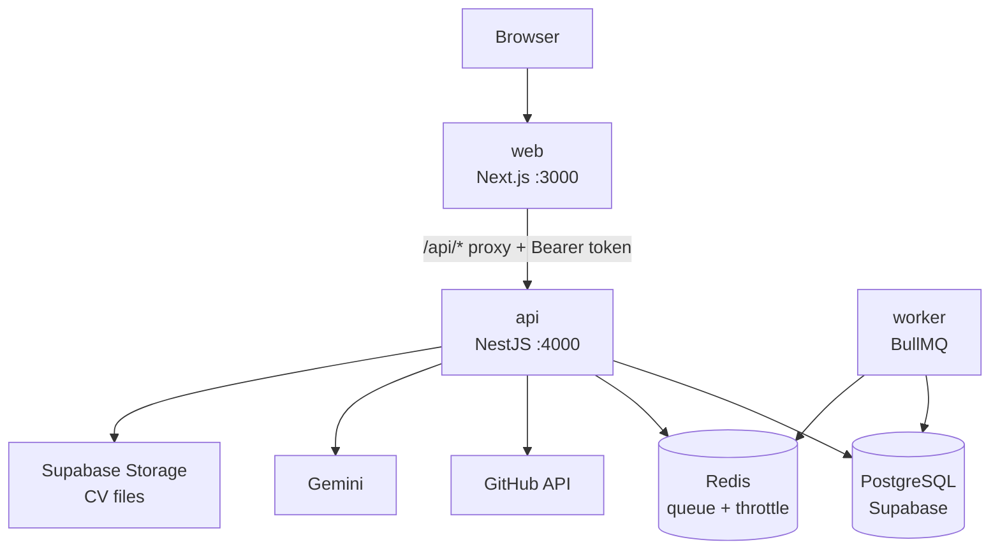

# Architecture

Runtime view for the shipped system. Product scope lives in `docs/requirements/`; build order in `docs/PROGRESS.md`.

## 1. Containers

| Container | Responsibility | Never does |
|---|---|---|
| `web` | UI, routing, animation, session cookie, proxy to API | Prisma, secrets, provider calls |
| `api` | AuthN/Z, business rules, AI, GitHub, persistence | Long-running jobs |
| `worker` | Sync, notifications, CV, badge evaluation | Serve HTTP |
| Redis | BullMQ queues, rate-limit counters, short-lived cache | Durable state |
| Postgres | All durable state | — |

At the target scale (≈2,000 users) this runs on one host: 1 `web`, 1 `api`, 1 `worker`, 1 Redis, managed Postgres.

In the **demo compose** a local Postgres service substitutes for the managed one so the golden path does not depend on a free project staying awake; Supabase still supplies Auth and Storage. Production uses the Supabase poolers. See `decisions/0006-local-postgres.md`.

## 2. Request flow

1. The browser calls `web`. Session cookies are set on the `web` origin only.
2. `apps/web/app/api/[...path]/route.ts` forwards to `API_URL` with `Authorization: Bearer <supabase access token>`.
3. `api` verifies the JWT (JWKS, ES256), loads the user role, runs guards, then the service.
4. Services own all rules: ownership, AI limits, GitHub quotas, state transitions.
5. Responses are Zod-parsed before leaving the API.

Same-origin proxy means **no CORS and no cross-site cookies**. The API port is not exposed publicly in production.

## 3. Identity and authorization

- Supabase Auth issues the access token (email/password and GitHub OAuth).
- `apps/api` verifies it against `https://<ref>.supabase.co/auth/v1/.well-known/jwks.json`. Roles come from `users.role`, not from a client-supplied claim.
- Three gates: `JwtAuthGuard` (authenticated) → `RolesGuard` (Developer/Maintainer/Admin) → service-level ownership check (`userId === resource.userId`).
- RLS policies are the second line of defence for anything reachable with the Supabase client; they are never the only check.
- The GitHub OAuth `provider_token` is captured at callback, encrypted with AES-256-GCM (`GITHUB_TOKEN_ENC_KEY`), stored per user, and only decrypted inside the GitHub client. It is never refreshed; on 401 the user is asked to reconnect.

## 4. Jobs

> Cron enqueues. The worker works. One job = one row, keyed for idempotency.

| Job | Trigger | Idempotency key |
|---|---|---|
| `github.sync.progress` | every 5 min | `issue:<id>:<state>` |
| `github.sync.saved` | every 15 min | `saved:<id>:<state>` |
| `notifications.deliver` | after events, batched | `event:<id>:<channel>` |
| `cv.extract` | on upload | `cv:<fileId>` |
| `gamification.evaluate` | after a merge | `badge:<userId>:<badge>` |
| `admin.aggregate` | every 5 min | `agg:<window>` |

Retries: 3, exponential backoff, then dead-letter. A repeated GitHub event must not create a second history row, badge or notification.

## 5. AI pipeline

| Feature | Shape |
|---|---|
| Issue ranking | rules pre-filter (≤20 candidates) → Gemini JSON `{issueId, rank, reason}` → validate ids → deterministic fallback on timeout/invalid |
| Onboarding | one structured call per repository/issue, cached by repo + commit sha and issue `updated_at` |
| AI guide | per-issue context + history, non-streaming JSON under an 8s budget, token-metered per message; SSE is deferred |

Guardrail: system prompt + output post-filter (reject fenced code, diffs, step-by-step implementations) + `docs/Sprints/sprint3/02-testing.md` eval suite. Every AI call writes a usage row (feature, tokens, model, userId) **before** returning.

## 6. GitHub pipeline

- Search API is the tightest quota (~30 req/min authenticated). Never search per user per request: build a **shared candidate pool** per language/label/activity window, cache it, and let each user's ranking read from it.
- Repository context (README, tree, CONTRIBUTING) is fetched once per repo and cached with an ETag.
- Status mapping: no PR → `In Progress`; open PR → `PR Open`; merged PR → `Merged`; closed unmerged → back to `In Progress` with a note.
- Webhooks are preferred when the repo is visible to the connected account; polling is the fallback and must be conditional (`If-None-Match`).

## 7. Freshness and caching

| Data | Rule |
|---|---|
| Auth-gated pages | never cached; `react-query` with explicit invalidation after mutations |
| Public profile | cacheable, revalidated on profile change (tag-based) |
| Candidate pool | 5–15 min TTL, shared across users |
| Admin figures | materialized view refreshed ≤5 min (BR-3) |
| Issue onboarding | cached per repo/issue version until GitHub `updated_at` changes |

## 8. Failure behaviour

| Dependency fails | User sees |
|---|---|
| Gemini slow/down | heuristically ranked three issues, labelled "ranked by rules" |
| GitHub rate-limited | cached pool + `Retry-After` message, never a blank screen |
| Redis down | API still serves reads; enqueue returns 503 with a clear message |
| Supabase paused/unreachable | health check fails, deploy stays on previous revision |

No request path may depend on an AI call succeeding.

## 9. Deployment

- One multi-stage Dockerfile per service (`apps/web`, `apps/api`, `apps/worker`), published as three GHCR packages.
- Published to GHCR by `.github/workflows/docker.yml`, tagged `sha` always and `latest` on `main`.
- `docker compose up --build` runs the whole system locally against managed Supabase.
- Migrations run as a release step (`prisma migrate deploy`), never on app boot.

## 10. Scale path (documented, not built)

1. Redis-backed rate limits and shared cache — already in place.
2. Read replica for public profiles and admin aggregates.
3. Extract the busiest module (`discovery`) into its own service; the boundary already exists in `apps/api/src/modules`.
4. Only then consider splitting the API from the web deploy.

## 11. Accepted constraints

- Two frameworks and two deploys (recorded in `decisions/0001-nest-next.md`).
- One database for all modules; isolation is by module + RLS, not by service.
- No WebSockets; the worker writes, the UI polls or uses SSE.
