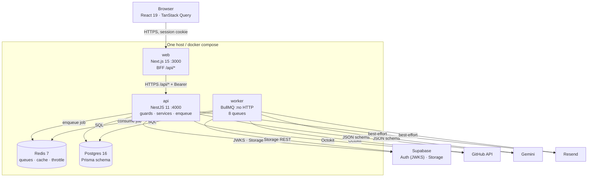

# 01 — Containers (PM1 level 1)

One container per deployable unit. Web serves the browser and proxies to the
API; the worker consumes BullMQ jobs and shares the API's database (ADR 0003).
Each container has its own multi-stage Dockerfile in `apps/<name>/Dockerfile`.

## Container responsibilities

| Container | Owns | Never does |
|---|---|---|
| `web` | UI, route protection cookie refresh, BFF proxy, public SSR pages | Prisma, provider calls, secrets |
| `api` | AuthN/Z, business rules, Zod response shaping, enqueue | Long-running work, serving static assets |
| `worker` | CV, sync, notifications, badges, admin aggregate, deletion | Serve HTTP |
| Redis | job queues, 5–24 h caches, rate-limit counters | durable product state |
| Postgres | all durable state | — |

## Protocols

| From → To | Protocol | Auth |
|---|---|---|
| Browser → web | HTTPS | Supabase session cookie |
| web → api | HTTP(S), same-origin proxy server-side | `Authorization: Bearer <access token>` |
| api/worker → Postgres | TCP 5432 (pooled in production) | connection string |
| api/worker → Redis | RESP | `REDIS_URL` |
| api/worker → Supabase | HTTPS | anon key for auth, service role for storage |
| api/worker → GitHub | HTTPS | decrypted provider token or public fallback |
| api/worker → Gemini | HTTPS | `x-goog-api-key` |
| api/worker → Resend | HTTPS | Bearer API key |

## Deployment

`docker compose up --build` starts web, api, worker, redis, postgres and a
one-shot migrate. Images are published to GHCR with `sha` and `latest`.
Migrations run as a release step, never on app boot.

## Traceability

| Element | Code/config |
|---|---|
| web | `apps/web`, `apps/web/Dockerfile` |
| api | `apps/api/src/main.ts`, `apps/api/Dockerfile` |
| worker | `apps/api/src/worker.ts`, `apps/api/src/jobs/worker-runner.ts` |
| Redis | `apps/api/src/infra/redis.service.ts`, `queue.service.ts` |
| Postgres | `apps/api/prisma/schema.prisma` |
| migrate | `apps/api/prisma/migrations/*`, compose `migrate` service |
| CI | `.github/workflows/ci.yml`, `docker.yml` |
