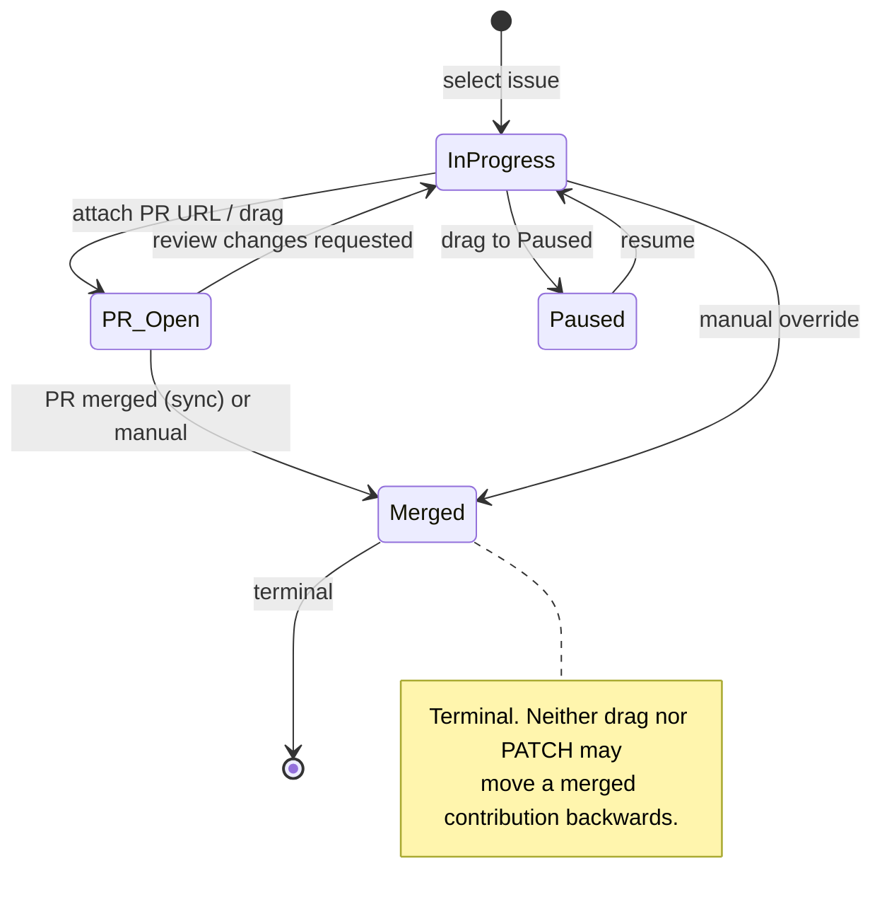

# 06 — Progress state diagram

The state machine behind `/progress` and the Trello-style board. A contribution
moves forward manually (drag, dialog, PR link) or by GitHub sync. Every change
writes a `ProgressEvent` and an in-app notification.

## Transitions

| From | To | Who | Guard | Side effects |
|---|---|---|---|---|
| — | `IN_PROGRESS` | Developer | profile complete, issue open, no active issue | selection row, first event, notification |
| `IN_PROGRESS` | `PR_OPEN` | Developer / sync | PR URL is a GitHub PR link when supplied | event, notification, badge job |
| `PR_OPEN` | `MERGED` | sync / Developer | sync sees a merged PR | event, notification, badge job |
| `PR_OPEN` | `IN_PROGRESS` | Developer / sync | review requested changes | event, notification |
| `IN_PROGRESS` | `PAUSED` | Developer | — | event, notification |
| `PAUSED` | `IN_PROGRESS` | Developer | no other active issue | event, notification |
| `MERGED` | any | — | rejected with `ALREADY_MERGED` | none |

## Board mapping

| Column | Status | Drop allowed |
|---|---|---|
| In Progress | `IN_PROGRESS` | yes |
| PR Open | `PR_OPEN` | yes |
| Merged | `MERGED` | yes, from any non-merged state |
| Paused | `PAUSED` | yes |

Cards in `MERGED` are not draggable. Dropping onto the same column is a no-op.
A failed transition shows the API error and leaves the card where it was.

## Implementation

- Contract: `UpdateProgressSchema`, `ProgressStatusSchema` in `packages/contracts`.
- API: `PATCH /progress/:id` → `SelectionService.update` (ownership re-checked).
- Notification: `NotificationsService.create` with `dedupeKey progress:<selection>:<event>`.
- Worker: `SyncService` applies `SYNC` events and notifications for PR state.
- UI: `apps/web/app/(app)/progress/page.tsx` (drag) and the Progress tab on the
  issue page (timeline + dialog).

## Traceability

| Element | Artifact |
|---|---|
| States and guards | `apps/api/src/modules/selection/selection.service.ts` |
| Sync transitions | `apps/api/src/jobs/sync.service.ts` |
| Contract | `packages/contracts/src/discovery.ts`, `common.ts` |
| Board UI | `apps/web/app/(app)/progress/page.tsx` |
| Tests | `selection.service.spec.ts`, `sync` integration |
